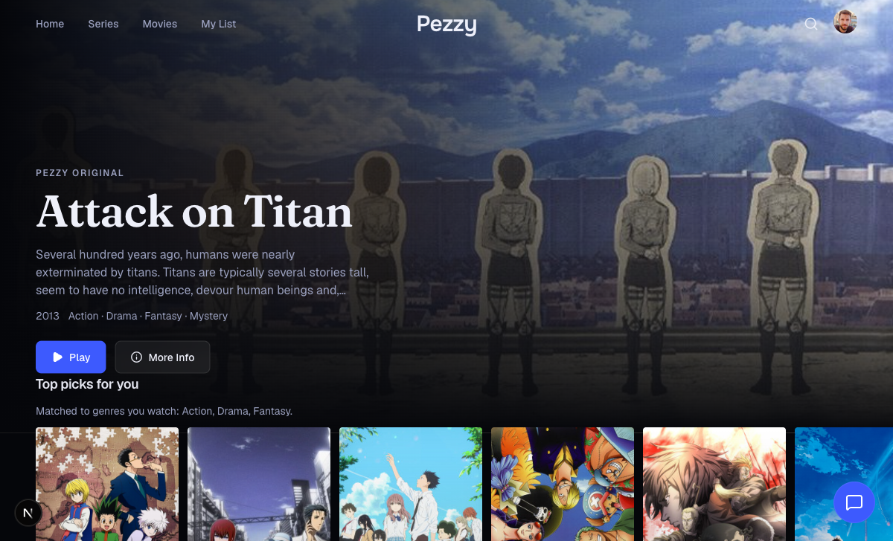

# Pezzy

A streaming front-end built the way a real one has to be built: a catalog that
scales, a player that isn't a wrapped `<video>` tag, and a hard security
boundary between the app and whatever is serving the media.

Runs from a fresh clone with no keys and no configuration. The bundled demo
source plays Creative Commons films, so everything below — the proxy, the HLS
rewriter, the quality menu, the resume-watching flow — is exercised against real
multi-rendition streams rather than fixtures.

```bash
npm install
npm run dev     # http://localhost:3000
```



---

## What's actually interesting here

Most "Netflix clone" projects stop at the grid. The parts of this one worth
reading:

**A media proxy that never leaks an upstream URL.** The browser is handed
opaque, short-lived tokens instead of source URLs. `/api/anime/proxy` resolves a
token server-side, replays the origin's required headers, and — for HLS —
rewrites every URI in the manifest recursively so segments, keys, audio tracks,
and subtitle playlists all come back through the same boundary.
[`anime-proxy.ts`](src/lib/anime-proxy.ts)

**An egress guard that assumes the media source is hostile.** An HLS manifest is
just text naming more URLs to fetch, which makes it an SSRF primitive pointed at
your own infrastructure. Every server-side fetch goes through
[`safe-fetch.ts`](src/lib/safe-fetch.ts): scheme and hostname screening, DNS
resolution checked against private ranges, redirect hops re-validated
individually, and the socket pinned to the verified address so a DNS record
can't change between the check and the connection. Details and the reasoning:
[docs/SECURITY.md](docs/SECURITY.md)

**A pluggable source boundary.** Playback sits behind a
[`StreamResolver`](src/lib/stream-resolver.ts) interface — resolve `(title,
episode, language)` to playable URLs, and nothing else in the app knows where
they came from. Resolvers race, the first useful answer wins, and failures come
back structured per resolver.

**A catalog that's a build artifact, not an API call.** `npm run catalog`
compiles ~750 franchises from AniList, per-season episode data from Kitsu, and
title logos from TMDB into a single snapshot served from memory. No per-request
third-party calls, no rate limits in the hot path, no API keys at runtime.
[`build-catalog.mjs`](scripts/build-catalog.mjs)

**A player written from scratch.** Custom controls, caption and quality menus,
keyboard shortcuts, HLS and progressive playback, sub/dub switching, subtitle
track selection, intro-skip, and resume-from-progress.
[`video-player.tsx`](src/components/ui/video-player.tsx)

---

## Content

**Pezzy ships no anime and holds no anime rights.** The catalog is *metadata*
— titles, synopses, episode lists, artwork references — from AniList's public
API and Kitsu. Playback is deliberately abstracted behind an interface with a
demo implementation.

The bundled [`OpenMovieResolver`](src/lib/resolvers/open-movie-resolver.ts)
serves:

| Title | Source |
|---|---|
| Big Buck Bunny | © Blender Foundation — CC BY 3.0 |
| Tears of Steel | © Blender Foundation — CC BY 3.0 |
| Mux / Apple HLS examples | public test streams |

Cover art in the catalog snapshot references AniList's CDN and remains the
property of the respective rights holders.

To run this with real content, implement `StreamResolver` against a source you
have rights to — object storage you control, or a licensed partner API — and add
it to the `resolvers` array in [`anime.ts`](src/lib/anime.ts). Everything
downstream, including the security boundary, applies unchanged.

---

## Stack

**Next.js 16** (App Router, Turbopack) · **React 19** · **TypeScript** ·
**Tailwind v4** (CSS-var tokens, no config file) · **motion** ·
**Three.js** via `@react-three/fiber` + `drei` + `postprocessing`

Server work runs in Route Handlers under `src/app/api/*`. Local persistence uses
Node's built-in SQLite driver — profiles, My List, watch progress, and playback
settings in `.pezzy/pezzy.db`. No ORM, no daemon, no Docker.

Typography is Satoshi, self-hosted; Assistant via `next/font` for Hebrew.

---

## AI layer

Pezzy's premise is that the catalog is table stakes and the personalization
layer is the product — a chatbot that knows your watch history, homepage rows
you can talk to, on-demand subtitles and translation, avatars from a selfie.

Those routes (`recommend`, `chat`, `avatar`, `subtitles`) exist as **stubs
behind a finished server boundary**: schema validation, `cached()`,
`checkRateLimit()`, and a strict rule that no provider key ever reaches the
client. The model calls themselves are marked `TODO(llm)` and are the other
founder's half of the project — see
[docs/AI-ARCHITECTURE.md](docs/AI-ARCHITECTURE.md).

The interesting constraint: anything that generates costs money per call, so
caching and rate limiting are structural rather than an optimization pass.

---

## Commands

```bash
npm install
npm run dev      # dev server (Turbopack)
npm run build    # production build
npm run lint     # eslint
npm run catalog  # regenerate the catalog snapshot (network, ~10 min)
```

`npm run build` and `npm run lint` are the verification signals — there is no
test suite yet, which is the most honest gap in the project.

---

## Docs

- [docs/PRD.md](docs/PRD.md) — product thinking, risks, open decisions
- [docs/ARCHITECTURE.md](docs/ARCHITECTURE.md) — module map and ownership split
- [docs/SECURITY.md](docs/SECURITY.md) — threat model and the untrusted-source boundary
- [docs/AI-ARCHITECTURE.md](docs/AI-ARCHITECTURE.md) — the AI layer's design

---

## Status

A working prototype, not a product. Auth, remote persistence, and the licensed
production video stack (transcoding, CDN, DRM, durable session state) are
deliberately unbuilt — see the "Stack gaps" section of the PRD.

Built by [Hen](https://github.com/Hezi777) and
[Perry](https://github.com/perrys21).
